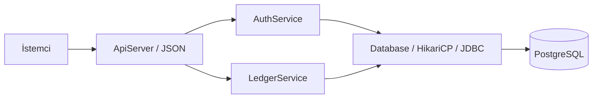

# Tasarım

HTTP isteği `ApiServer` tarafından ayrıştırılır; oturum `AuthService` tarafından çözülür; para hareketi `LedgerService` üzerinden `Database.transaction` içinde yürütülür. JDBC kullanılması SQL'i, bağlantı yaşam döngüsünü ve transaction sınırını açıkça görmeyi sağlar. Servislerin HTTP bağımlılığı yoktur.

## Veri modeli

`users` kimlik ve rolü, `sessions` token özetlerini, `auth_rate_limits` paylaşılan hız sınırlarını tutar. `accounts` bakiyenin hızlı okunmasını sağlar. `transfers` hareketin başlığını, `ledger_entries` iki taraflı defterini, `idempotency_keys` istek ile sonuç bağını ve `audit_events` finansal yönetim izini tutar.

Bir transferin eksi ve artı olmak üzere tam iki defter satırı vardır. `100.00 TRY` gönderiminde kaynak `-100.00`, hedef `+100.00` yazar. Bakiyeler `numeric(19,2)`, Java değerleri `BigDecimal` olur. HTTP'de tutarlar metindir; `double` kullanılmaz. Tek işlem üst sınırı `999999999999.99`, toplam bakiye sınırı SQL tipinin sınırıdır.

Hesaplar sıfır bakiyeyle açılır. TRY/USD/EUR için birer sistem hazinesi bulunur; admin yüklemesinde hazine eksi, müşteri hesabı artı hareket alır. Sistem hazinesi eksiye inebilir; müşteri hesabı inemez. Böylece para sisteme girerken de defterin toplamı sıfır kalır.

## Transfer transaction'ı

1. Anahtar, UUID, tutar ve metin sınırlarını doğrula.
2. Transaction başlat; actor+key için PostgreSQL transaction advisory lock al.
3. Anahtar mevcutsa normalize edilmiş isteğin SHA-256 özetini karşılaştır ve mevcut sonuca dön; farklı içerikte `409`.
4. İki hesabı **her zaman aynı UUID sırasıyla** `SELECT ... FOR UPDATE` ile kilitle.
5. Kaynak sahipliğini, para birimini, hesap durumlarını ve güncel bakiyeyi kontrol et.
6. Transferi, iki bakiye değişimini, iki defter satırını, idempotency sonucunu ve audit olayını yaz.
7. Commit sırasında ertelenmiş PostgreSQL constraint trigger'ları defter ve bakiye eşitliğini doğrular.
8. Herhangi bir istisnada rollback yap; bağlantıyı havuza geri ver.

`READ COMMITTED` tek başına bakiye güvenliği sağlamaz. Güvenliği sağlayan, kontrollerden **önce** alınan satır kilidinin commit'e kadar tutulmasıdır. Aynı hesaptan yarışan farklı istekler güncel bakiyeyi sırayla görür. A→B ve B→A isteklerinde aynı kilit sırası deadlock riskini azaltır. Kilit ve sorgu süreleri sınırlıdır; bekleme sonsuz değildir.

Kilitleme Java `synchronized` ile yapılmaz; birden fazla uygulama süreci de aynı PostgreSQL kilitlerine tabidir. SQL unique kısıtları actor+key, reversal_of ve dış tahsilat kimliği için son savunmadır. Hash çakışan advisory lock'lar yalnızca gereksiz beklemeye neden olur; unique kısıtların doğruluğunu değiştirmez.

## SQL savunmaları

Defter, transfer, idempotency ve audit tablolarında update/delete/truncate engellenir. Hesap kimliği, sahibi, para birimi ve türü değiştirilemez. Kapalı hesap yeniden açılamaz ve kapatıldığında bakiyesi sıfır olmalıdır.

Commit denetimi her transferin doğru hesap ve tutarlara sahip iki satır içerdiğini, para birimlerinin eşitliğini ve her bakiyenin kendi defter toplamına eşitliğini kontrol eder. Sadece Java validasyonuna güvenilmez. Şema sahibi/superuser bu savunmaları kaldırabildiğinden runtime rolü tablo sahibi olmamalıdır.

## Geri alma

Rollback ile telafi farklıdır. Rollback commit edilmemiş çalışmayı tamamen iptal eder. Telafi ise commit edilmiş hareketin tersini yeni ve görülebilir bir kayıt olarak ekler. `reversal_of UNIQUE` ve orijinal transfer başına kilit, farklı idempotency anahtarlarıyla gelen eşzamanlı telafilerin de tek defa gerçekleşmesini sağlar.

Telafi alıcıdan geri para alır; alıcı parayı harcamışsa negatif müşteri bakiyesi yaratılmaz. Transfer geçmişi orijinali `REVERSED`, telafi kaydını `COMPLETED` olarak gösterir. Finansal geçmiş silinmez.

## HTTP ve hata yönetimi

Gövde 16 KiB, JSON derinliği 8 ile sınırlıdır. Fazladan alanlar, tekrarlanan alanlar, yinelenen Authorization/Idempotency-Key ve belirsiz query parametreleri reddedilir. SQL girdileri PreparedStatement parametreleri olarak bağlanır. Büyük tutar metni, bilimsel gösterim ve fazla ondalıklar yuvarlanarak kabul edilmez.

Hatalar `application/problem+json` biçimindedir ve `requestId` taşır. Parola, token, gövde ve SQL mesajları loglanmaz. Beklenmeyen DB hatalarında `503 DATABASE_UNAVAILABLE` döner; commit sonucunun belirsiz olabildiği bağlantı hatalarında istemci aynı anahtarla yeniden dener.

## Büyüme sınırları

Bu sürümde banka adaptörü, döviz, faiz, ücret, rezervasyon/hold, dağıtık outbox ve bildirim sistemi yoktur. Hesap listesi sayfalanmaz; işlem geçmişi `limit` 1–100 ve `offset` 0–1.000.000 aralığındadır. Yazma sürerken offset sayfalama farklı sayfalar arasında kayabilir; finansal dışa aktarım için snapshot/cursor tasarımı eklenmelidir.

Defter toplamını doğrulayan SQL kontrolleri hesap geçmişi büyüdükçe daha pahalı olur; aynı para biriminin hazine satırı yüklemeleri sıraya koyar. Yüksek hacimli trafik için gerçek veri boyutlarıyla ölçüm gerekir. Sonraki adım trigger'ların bakiyeyi yönetmesi, bağımsız periyodik mutabakat ve cursor sayfalamadır; doğrulama mekanizmasını kaldırmak çözüm değildir.

## Kaynaklar

- [PostgreSQL satır kilitleri](https://www.postgresql.org/docs/18/explicit-locking.html)
- [OWASP parola saklama rehberi](https://cheatsheetseries.owasp.org/cheatsheets/Password_Storage_Cheat_Sheet.html)
- [pgJDBC](https://jdbc.postgresql.org/)
- [Flyway PostgreSQL desteği](https://documentation.red-gate.com/flyway/reference/database-driver-reference/postgresql-database)
